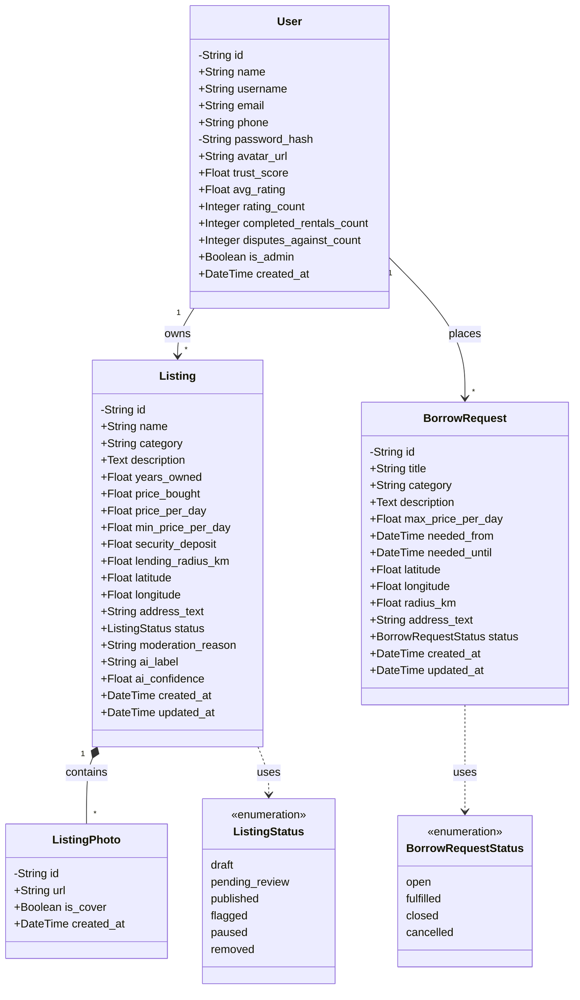

# NeighborLend - Architecture & Class Diagram

This document provides a clear overview of the file architecture and the core business logic classes (database models) used in the NeighborLend application, following standard UML guidelines. 

## 1. File Architecture

The project is structured as a modern full-stack web application with a clear separation of concerns.

### Frontend (`/frontend`)
Built with React and Vite.
- **`src/api/`**: Contains `client.js` for Axios configuration and interceptors to communicate with the backend.
- **`src/components/`**: Reusable UI components (e.g., `Navbar.jsx`, `ListingCard.jsx`, `Footer.jsx`).
- **`src/context/`**: React Context providers for global state management (e.g., `AuthContext.jsx`).
- **`src/pages/`**: Top-level page components representing routes (e.g., `Home.jsx`, `Browse.jsx`, `CreateListing.jsx`, `Register.jsx`).
- **`src/design/`**: Global stylesheets and CSS variables.

### Backend (`/backend`)
Built with Python and FastAPI.
- **`app/models.py`**: SQLAlchemy ORM models defining the database schema and relationships (the core classes of our system).
- **`app/schemas/`**: Pydantic models for data validation, serialization, and deserialization (API request/response payloads).
- **`app/routers/`**: FastAPI route handlers defining the API endpoints (e.g., `auth.py`, `listings.py`, `uploads.py`).
- **`app/services/`**: Business logic, external integrations, and ML services (e.g., `ml_service.py`, `storage_service.py`).
- **`app/database.py`**: Database connection setup and session management.
- **`ai_service/`**: Contains the YOLO ML models (`best_model.pt`) used for image object detection.

---

## 2. UML Class Diagram

The following class diagram illustrates the core entities of the application based on our backend database models (`app/models.py`), adhering to standard UML guidelines.

### Class Diagram Details
- **Classes** contain attributes and their data types.
- **`+`** denotes public attributes (accessible publicly).
- **`-`** denotes private attributes (internal to the class/system, such as IDs or password hashes).
- **Association**: `User` is associated with `BorrowRequest` (A user places a borrow request).
- **Composition**: `Listing` has a composition relationship with `ListingPhoto`. A photo cannot exist without its parent listing (represented by a filled diamond in UML, `*--` in Mermaid).
- **Aggregation / Association**: `User` owns a `Listing` (A listing belongs to a user, represented by an empty diamond or standard association).

### Explanation of the UML Class Architecture

1. **User**: The central entity representing a registered user on the platform. It holds both authentication data (private) and public profile metrics (`trust_score`, `avg_rating`).
2. **Listing**: Represents an item available for rent. It is associated with a specific `User` (the owner). It relies on the `ListingStatus` enumeration to track its lifecycle.
3. **ListingPhoto**: Represents images uploaded for a listing. It has a **Composition** relationship with `Listing`, meaning that if a `Listing` is deleted, its associated `ListingPhoto` objects are also destroyed (handled via cascade delete).
4. **BorrowRequest**: Represents a user's request to borrow an item they couldn't find in the listings. It is associated with the `User` (the borrower) and utilizes the `BorrowRequestStatus` enumeration.
